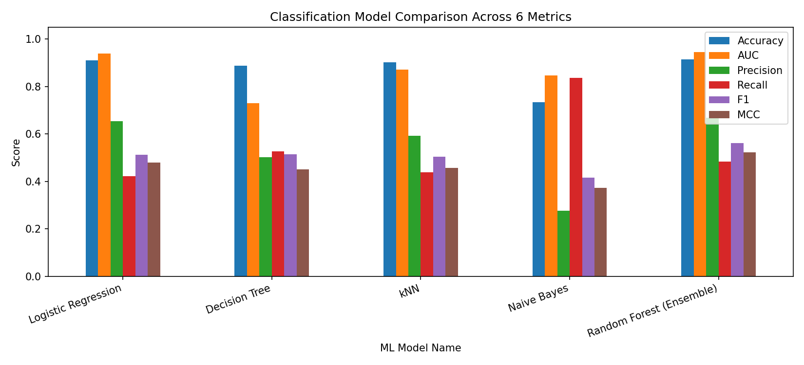

# Term Deposit Subscription Prediction

## 1. Problem Statement
This project predicts whether a bank customer will subscribe to a term deposit (`y`: `yes` or `no`) based on customer details, marketing call history, and economic indicators from `bank-additional-full.csv`.

## 2. Dataset Description
- **Source:** UCI Machine Learning Repository — Bank Marketing Dataset (ID 222), file `bank-additional-full.csv` (Moro et al., 2014).
- **Rows and Columns:** Started with `41,188` rows and `21` columns (20 input features plus target `y`, mapped as `no` -> `0` and `yes` -> `1`).
- **Missing Values:** Several columns use `"unknown"` instead of blanks: `job` (330), `marital` (80), `education` (1731), `default` (8597), `housing` (990), and `loan` (990).
- **Class Balance:** The target is imbalanced—around `88.73%` (`0.887337`) are `no` and `11.27%` (`0.112663`) are `yes`.
- **Data Prep and How to Run:**
  - Dropped duplicate rows, split the data `80:20` with stratification (`random_state=42`), and saved `test_data.csv` with `target`.
  - Used a `ColumnTransformer` fitted only on the training data inside each model pipeline (`SimpleImputer` with median + `StandardScaler` for numeric columns; `SimpleImputer` with most frequent + `OneHotEncoder(handle_unknown="ignore")` for categorical columns).
  - Run from the main project folder:
    ```bash
    pip install -r requirements.txt
    python model/train_evaluate_2026ct05056.py
    ```

## 3. GitHub Repository Link
- **Repository:** `https://github.com/mathana-krishnan/ml-classification-assignment`

## 4. Models Used & Evaluation Metrics

| ML Model Name | Accuracy | AUC | Precision | Recall | F1 | MCC |
| :--- | :---: | :---: | :---: | :---: | :---: | :---: |
| Logistic Regression | 0.9097 | 0.9389 | 0.6538 | 0.4213 | 0.5125 | 0.4789 |
| Decision Tree | 0.8876 | 0.7302 | 0.5010 | 0.5269 | 0.5137 | 0.4503 |
| kNN | 0.9027 | 0.8718 | 0.5924 | 0.4386 | 0.5040 | 0.4577 |
| Naive Bayes | 0.7347 | 0.8474 | 0.2764 | 0.8373 | 0.4156 | 0.3728 |
| Random Forest (Ensemble) | 0.9148 | 0.9447 | 0.6687 | 0.4828 | 0.5607 | 0.5232 |



| ML Model Name | Observation about model performance |
| :--- | :--- |
| Logistic Regression | Good baseline with high AUC (`0.9389`) and decent precision (`0.6538`), though lower recall (`0.4213`) keeps F1 at `0.5125`. |
| Decision Tree | Slightly higher recall (`0.5269`) and F1 (`0.5137`) than Logistic Regression, but weaker AUC (`0.7302`) and precision (`0.5010`) because the tree was not pruned. |
| kNN | Solid accuracy (`0.9027`) and AUC (`0.8718`), but recall (`0.4386`) and MCC (`0.4577`) are moderate on the scaled and one-hot encoded feature space. |
| Naive Bayes | Caught the most `yes` cases with the highest recall (`0.8373`), but low precision (`0.2764`) and accuracy (`0.7347`) mean lots of false alarms. |
| Random Forest (Ensemble) | Best across Accuracy (`0.9148`), AUC (`0.9447`), Precision (`0.6687`), F1 (`0.5607`), and MCC (`0.5232`), handling non-linear patterns and imbalance better than single models. |
| **Overall Winner for your dataset?** | **Random Forest (Ensemble)** did best overall on this dataset because it led across all six metrics' main trade-offs, especially AUC, F1, and MCC. |
